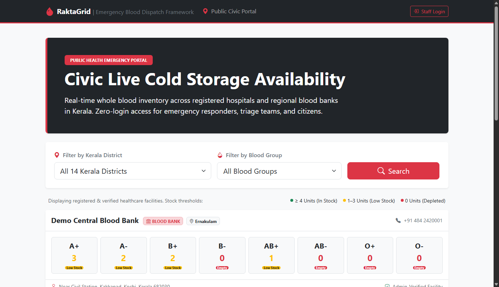
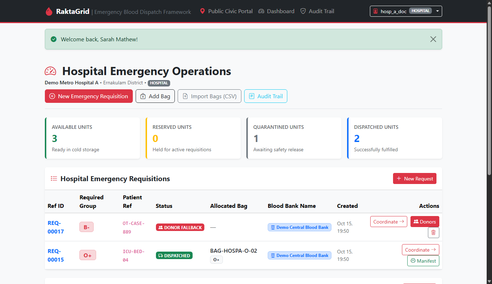
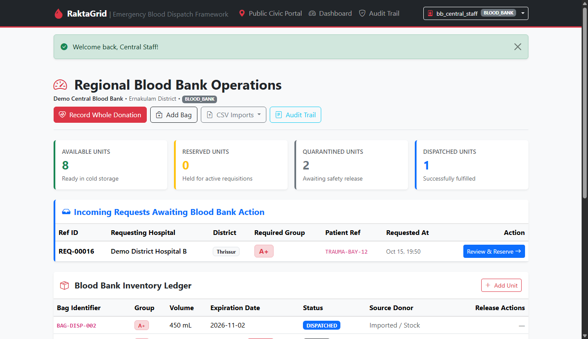
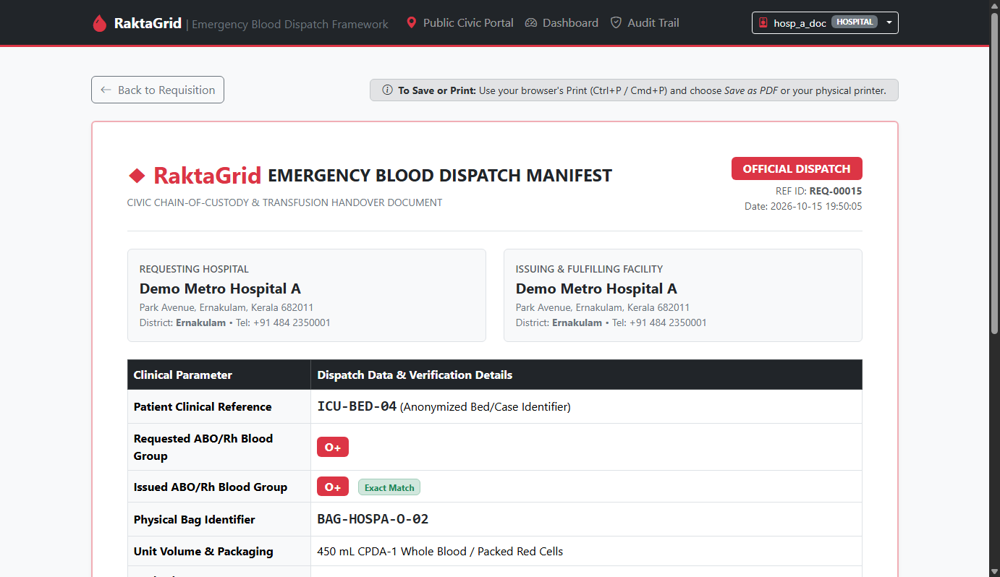
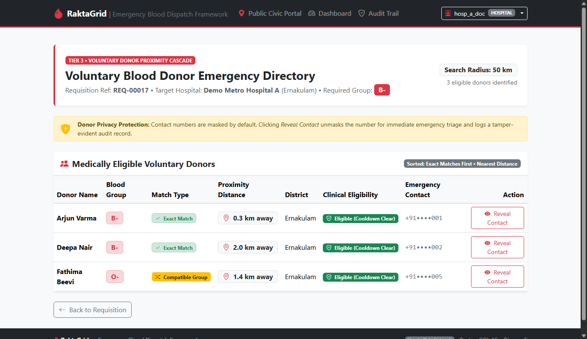
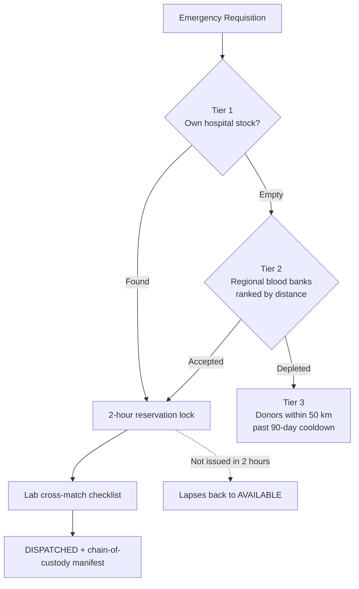

<div align="center">

# 🩸 RaktaGrid

**Emergency blood dispatch framework that stops double-allocation, protects donors, and finds life-saving units in seconds.**

[](https://raktagrid.onrender.com/)
[](https://www.djangoproject.com/)
[](https://www.python.org/)
[](https://www.postgresql.org/)
[](https://getbootstrap.com/)

[Live Demo](https://raktagrid.onrender.com/) · [Report Bug](https://github.com/MEHTHAB-N-M/RaktaGrid/issues)

</div>

---

> ⚠️ **CLINICAL & REGULATORY NOTICE**:
> RaktaGrid is a coordination and triage platform for emergency logistics. It is not a licensed blood bank management system or laboratory information system (LIS). All organisations, staff, donors and inventory in the demo are fictional. Never enter real patient names, national ID numbers or medical record identifiers.

---

## 📑 Table of Contents
- [Why RaktaGrid](#-why-raktagrid)
- [Screenshots](#-screenshots)
- [How It Works](#-how-it-works)
- [Key Features](#-key-features)
- [Roles & Access](#-roles--access)
- [Tech Stack](#-tech-stack)
- [Quick Start](#-quick-start)
- [Demo Accounts & Scenarios](#-demo-accounts--scenarios)
- [Design Decisions](#-design-decisions)
- [CSV Import](#-csv-import)
- [Testing](#-testing)
- [Maintenance](#-maintenance)
- [Not Modelled (Future Scope)](#-not-modelled-future-scope)
- [Author](#-author)

---

## 🎯 Why RaktaGrid

Emergency blood coordination suffers from three bottlenecks. RaktaGrid fixes each one.

| Problem | What goes wrong | How RaktaGrid solves it |
| :--- | :--- | :--- |
| **Double-allocation** | Several hospitals request the same scarce unit (e.g. O-negative). Two bookings land on one bag, and the cold-box arrives empty. | Atomic row-level locking with PostgreSQL `select_for_update(skip_locked=True)` |
| **Donor depletion** | Calls reach people who donated within weeks. This risks donor health and yields unusable units. | Mandatory 90-day cooldown filter on every donor query |
| **Access friction** | Paramedics and citizens can't afford logins or CAPTCHAs in an emergency. | Zero-login public search of live cold-storage counts |

---

## 📸 Screenshots

| Public Search (No Login) | Hospital Dashboard |
| :---: | :---: |
| [](docs/screenshots/public_search.png) | [](docs/screenshots/hospital_dashboard.png) |

| Blood Bank Queue | Dispatch Manifest |
| :---: | :---: |
| [](docs/screenshots/blood_bank_queue.png) | [](docs/screenshots/dispatch_manifest.png) |

| Donor Proximity Directory |
| :---: |
| [](docs/screenshots/donor_directory.png) |

---

## 🔄 How It Works

RaktaGrid mirrors the real movement of blood from donor to patient.



### Blood Lifecycle
1. **Donation &rarr; Quarantine**: New bags enter as `QUARANTINED` and cannot be reserved or dispatched until disease screening clears.
2. **Release**: The owning facility releases cleared bags to `AVAILABLE` cold storage.
3. **Matching**: Exact ABO/Rh match first, then safe compatible groups, saving O-negative for last.
4. **Reserve, then Issue**: A reservation holds the unit for 2 hours. Issue is allowed only after lab cross-match is ticked.
5. **Expiry**: Units past CPDA-1 shelf life (35–42 days) expire automatically, and stale reservations release back to stock.

---

## ✨ Key Features

- **Three-tier allocation engine**: Automatic failover Hospital &rarr; Blood Bank &rarr; Donors
- **Concurrency-safe reservations**: Proven by a 5-thread race test
- **ABO/Rh compatibility matrix**: Conserves universal O-negative units
- **Haversine proximity ranking (&le; 50 km)**: Proximity sorting for voluntary donors, with masked phone numbers unmasked only through audited actions
- **Printable dispatch manifest**: Browser-native, no PDF engine needed
- **Audit trail**: Every reservation, rejection, lapse, donation and contact reveal is recorded atomically
- **HMAC-SHA256 donor ID anonymisation**: Raw national IDs are never stored
- **All-or-nothing CSV import**: Batch CSV imports with per-row error diagnostics
- **Public rate limiter**: 30 requests/min per IP on public search

---

## 👥 Roles & Access

| Role | What they can do |
| :--- | :--- |
| **Hospital Staff** | Create requisitions &middot; check own stock &middot; route to blood banks &middot; cross-match and issue &middot; use donor fallback with audited contact reveal &middot; add/import inventory &middot; view hospital audit logs |
| **Blood Bank Staff** | Review incoming requisitions &middot; accept/reserve or reject with reason &middot; issue units &middot; record donations (blocks donors on cooldown) &middot; release quarantined bags &middot; CSV-import bags and donors &middot; view blood bank audit logs |
| **Platform Admin** | System-wide visibility &middot; read-only audit inspection |
| **Public / First Responders** | Live counts of available units across verified facilities. No donor data, patient references or bag numbers are exposed |

> **Multi-Tenant Isolation**: Staff are bound to their own organisation. Cross-tenant access returns HTTP 403 Forbidden.

---

## 🧱 Tech Stack

| Layer | Technology |
| :--- | :--- |
| **Backend** | Python 3.12+, Django 5.x |
| **Database** | PostgreSQL 16+ via `psycopg[binary]` |
| **Frontend** | Django templates, HTML5, CSS3, Bootstrap 5.3 + Icons (CDN) |
| **Hosting** | Render |

*Deliberately minimal: the only Python dependencies are Django and psycopg. No Redis, Celery, ReportLab or custom JavaScript.*

---

## 🚀 Quick Start

### Prerequisites
Python 3.12+ and PostgreSQL 16+.

```bash
# 1. Clone repository
git clone https://github.com/MEHTHAB-N-M/RaktaGrid.git
cd RaktaGrid

# 2. Create the database
psql -U postgres -c "CREATE DATABASE ebdf_db;"

# 3. Install dependencies
pip install django "psycopg[binary]"
```

### 4. Set environment variables

**macOS / Linux**:
```bash
export DB_NAME=ebdf_db
export DB_USER=postgres
export DB_PASSWORD=your_password
export DB_HOST=localhost
export DB_PORT=5432
export DEBUG=True
export SECRET_KEY="<generate-a-long-random-string>"
export DONOR_ID_PEPPER="<generate-a-long-random-string>"
```

**Windows PowerShell**:
```powershell
$env:DB_NAME="ebdf_db"
$env:DB_USER="postgres"
$env:DB_PASSWORD="your_password"
$env:DB_HOST="localhost"
$env:DB_PORT="5432"
$env:DEBUG="True"
$env:SECRET_KEY="<generate-a-long-random-string>"
$env:DONOR_ID_PEPPER="<generate-a-long-random-string>"
```

> [!IMPORTANT]
> Keep `DONOR_ID_PEPPER` stable once donors are imported. Changing it invalidates existing donor hashes.

### 5. Run Migrations & Start Server
```bash
# Migrate and create the cache table (used by the rate limiter)
python manage.py migrate
python manage.py createcachetable

# Seed fictional demo data
python manage.py seed_demo --reset

# Run development server
python manage.py runserver
```

Open [http://127.0.0.1:8000/](http://127.0.0.1:8000/).

---

## 🔑 Demo Accounts & Scenarios

| Facility | Username | Password | District |
| :--- | :--- | :--- | :--- |
| **Admin** | `admin` | `admin123` | System-wide |
| **Demo Metro Hospital A** | `hosp_a_doc` | `password123` | Ernakulam |
| **Demo District Hospital B** | `hosp_b_doc` | `password123` | Thrissur |
| **Demo North Trauma Center C** | `hosp_c_doc` | `password123` | Kozhikode |
| **Demo Central Blood Bank** | `bb_central_staff` | `password123` | Ernakulam |
| **Demo Malabar Zonal Blood Bank** | `bb_malabar_staff` | `password123` | Kozhikode |

*Demo credentials only. Never deploy with these.*

<details>
<summary><b>▶ Try the three pre-seeded scenarios</b></summary>

- **A. Hospital own-stock fulfilment**:
  Log in as `hosp_a_doc` &rarr; open requisition for O+ &rarr; Click **Check Own Stock Now**. Bag `#BAG-HOSPA-O-01` is reserved. Tick cross-match &rarr; **Issue Blood** &rarr; view the dispatch manifest.
- **B. Regional blood bank sourcing**:
  Log in as `hosp_b_doc` &rarr; open requisition for A+. Hospital B has no A+ stock, so select **Demo Central Blood Bank** &rarr; **Request from this blood bank**. Log in as `bb_central_staff` &rarr; **Accept and Reserve**.
- **C. Voluntary donor fallback**:
  Log in as `hosp_a_doc` &rarr; open requisition for B-. No facility holds B- or O-, so click **Activate Voluntary Donor Proximity Cascade**. Review eligible donors by distance &rarr; **Reveal Contact** &rarr; check the unmasking audit log.

</details>

---

## 🧠 Design Decisions

<details>
<summary><b>Row-level locking with <code>skip_locked</code></b></summary>

```python
candidate_bag = BloodInventory.objects.select_for_update(skip_locked=True).filter(
    owner=organisation, blood_type=group, status='AVAILABLE', expiry_date__gte=today
).order_by('expiry_date', 'id').first()
```
If another requisition has a bag locked, this transaction skips to the next candidate instead of waiting. That avoids both deadlocks and double-booking.

</details>

<details>
<summary><b>Why PostgreSQL, not SQLite</b></summary>

SQLite only offers coarse, database-level locking. PostgreSQL provides MVCC, granular row-level write locks and native JSONField querying for audit metadata. These are all needed for concurrent trauma-centre workloads.

</details>

<details>
<summary><b>90-day donor cooldown</b></summary>

Whole blood donation removes about 450–500 mL of red cells, and recovery takes 8–12 weeks.

```python
cooldown_cutoff = timezone.now().date() - timedelta(days=90)
Q(last_donated_date__isnull=True) | Q(last_donated_date__lte=cooldown_cutoff)
```

A donor at 89 days is excluded. At 90 days they're eligible.

</details>

<details>
<summary><b>Reserve-then-issue separation</b></summary>

- **Reserve**: The unit is locked for 2 hours so no one else takes it while samples go to the lab.
- **Issue**: Allowed only after the transfusion technologist confirms serological cross-match.

</details>

<details>
<summary><b>HMAC-SHA256 donor anonymisation</b></summary>

```python
hmac.new(settings.DONOR_ID_PEPPER.encode(), raw_id.strip().encode(), hashlib.sha256).hexdigest()
```

Raw national IDs are never written to the database. Hashes use a secret server-side pepper.

</details>

<details>
<summary><b>ABO/Rh compatibility hierarchy</b></summary>

| Recipient | Can receive |
| :--- | :--- |
| **AB+** | AB+, AB-, A+, A-, B+, B-, O+, O- |
| **AB-** | AB-, A-, B-, O- |
| **A+** | A+, A-, O+, O- |
| **A-** | A-, O- |
| **B+** | B+, B-, O+, O- |
| **B-** | B-, O- |
| **O+** | O+, O- |
| **O-** | O- only |

Exact matches are always tried first. O-negative is evaluated last to conserve it.

</details>

---

## 📥 CSV Import

Staff can batch-import records using downloadable templates. If any row fails validation, the whole import is rolled back and an itemised error report is shown.

| Import | Path | Columns | Access |
| :--- | :--- | :--- | :--- |
| **Blood inventory** | `/import/bags/` | `bag_number, blood_type, volume_ml, expiry_date, status` | Hospital + Blood Bank |
| **Donors** | `/import/donors/` | `donor_reference, full_name, blood_type, contact_number, district, latitude, longitude, last_donated_date` | Blood Bank only |

- Valid statuses: `AVAILABLE`, `QUARANTINED`, `EXPIRED`, `DISPATCHED`, `RESERVED`
- Dates use `YYYY-MM-DD`
- `donor_reference` is hashed with HMAC-SHA256 on ingestion
- District must be one of the 14 Kerala districts
- Latitude within -90 to 90, longitude within -180 to 180

---

## 🧪 Testing

```bash
python manage.py test
```

<details>
<summary><b>Test coverage highlights (21 tests)</b></summary>

| Suite | Verifies |
| :--- | :--- |
| `DonorCooldownTests` | New donors eligible; excluded at 89 days; eligible at 90 |
| `BloodInventoryValidationTests` | Past-expiry bags can't be AVAILABLE or RESERVED |
| `ThreeTierWorkflowTests` | Own-stock allocation, blood bank failover, rejection rollback, donor cascade |
| `IssueSafetyTests` | No issue without cross-match; quarantined/expired bags never reserved |
| `BloodCompatibilityTests` | Compatible substitution; O-negative conserved |
| `ExpireBagsCommandTests` | Overdue stock expires; lapsed reservations release |
| `RecordDonationAndReleaseTests` | Cooldown donors rejected; quarantine release works |
| `OrganisationIsolationTests` | HTTP 403 across tenant boundaries |
| `CSVImportTests` | Atomic rollback on invalid rows |
| `PublicPageAndRateLimitTests` | Zero-login access; HTTP 429 after 30 requests/min |
| `ManifestAndProximityTests` | Haversine accuracy (111.19 km/degree) and manifest layout |
| `ConcurrencyLockingTests` | 5 threads, 1 scarce unit: exactly one reservation succeeds |
| `EmergencyRequestDeleteTests` | Safe deletion and reserved bag restoration |

</details>

---

## 🛠️ Maintenance

```bash
python manage.py expire_bags
```
Marks overdue units `EXPIRED` and releases lapsed reservations back to `AVAILABLE`, resetting the requisitions. Safe to run repeatedly from cron.

---

## 🚧 Not Modelled (Future Scope)

- Clinician requisition and hemovigilance forms (patient history, transfusion reactions)
- Laboratory specimen handling (centrifugation, antibody screening, Rh phenotyping)
- Component fractionation (PRBC, FFP, cryoprecipitate, platelets)
- Government processing and screening fees
- Replacement-donor pledges and exchange credits

---

## 👨‍💻 Author

**Mehthab N M** &mdash; Full-Stack & Python Developer  
[Portfolio](https://mehthab-n-m.github.io/My_portfolio/) · [GitHub](https://github.com/MEHTHAB-N-M) · [LinkedIn](https://www.linkedin.com/in/mehthab-n-m-637611344)

---

<div align="center">
⭐ If you find this project useful, consider giving it a star on GitHub!
</div>
